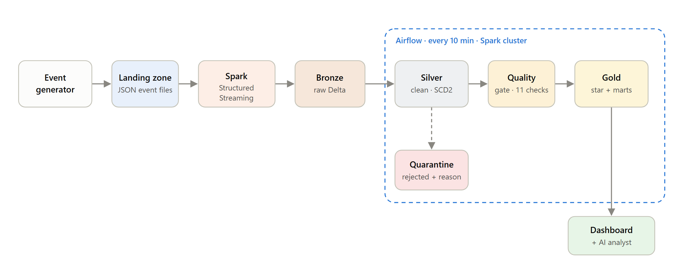
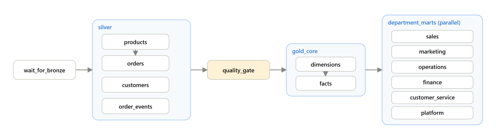

# E-Commerce Streaming Lakehouse with AI Analyst

An end-to-end data engineering project for a fictional online store, **Northstar Commerce**.
A Python **event generator** simulates a live store: orders, customer updates and the full order
lifecycle (payments, shipments, deliveries, returns, reviews), including late-arriving, duplicate
and deliberately broken records. **Spark Structured Streaming** ingests the events incrementally
into a **Delta Lake** Bronze → Silver → Gold architecture, and **Airflow** orchestrates the Spark
jobs every 10 minutes. The result feeds **Northstar Insights**, a decision dashboard for five
business departments with an **AI analyst** that answers business questions by querying the warehouse.

## Architecture



## Orchestration



`lakehouse_medallion` runs every 10 minutes: a sensor waits for Bronze, the Silver entities load in
parallel, the data-quality gate blocks bad data, then dimensions, facts and six department marts
are built. Every Spark task shares a 3-slot pool on the cluster. A second DAG,
`lakehouse_maintenance`, runs Delta `OPTIMIZE` and `VACUUM` nightly.

## Data engineering concepts shown

| Concept | Where |
| --- | --- |
| Realistic event simulation | `generator/`: customers, orders and lifecycle events with late, duplicate (~1%) and corrupt (~0.6%) records |
| Medallion architecture (Bronze / Silver / Gold) on Delta Lake | `lakehouse/bronze_stream.py`, `silver.py`, `gold.py` |
| Spark Structured Streaming with checkpoints (exactly-once into Delta) | `bronze_stream.py`: one streaming query per event stream, source file kept with every record |
| Incremental processing | Silver reads Bronze as a stream with `trigger(availableNow=True)`; the checkpoint is the watermark |
| Idempotent upserts | Delta `MERGE` on business keys; quarantine appends use `txnAppId/txnVersion` |
| Deduplication | duplicate events removed by `event_id` / `order_id` |
| Schema enforcement and data validation | explicit schemas in `schemas.py`, rule-based rejection reasons in `silver.py` |
| Quarantine (dead-letter) pattern | `silver/quarantine` keeps the raw payload, source file and the reason it failed |
| Slowly Changing Dimension Type 2 | customer tier and address history in `silver/customers` |
| Point-in-time join | each order joins the customer version valid at order time (`gold.py`) |
| Dimensional modelling | `dim_date`, `dim_product`, `dim_customer` (with an unknown member), `fact_orders`, `fact_order_items` |
| Data-quality gate | uniqueness, referential integrity, SCD2 validity, quarantine rate and freshness; failures stop Gold (`quality.py`) |
| Orchestration | Airflow DAG with sensor, task groups, a Spark pool, retries and parallel marts (`airflow/dags`) |
| Table maintenance | nightly Delta `OPTIMIZE` and `VACUUM` |
| Analytics engineering | RFM segmentation, weekly cohort retention, revenue bridge, fulfilment SLAs |
| AI over the warehouse | LLM agent that writes and runs read-only SQL to answer questions and draft decisions (`ai/`) |
| Testing | generator unit tests and Spark tests for validation, MERGE idempotency and SCD2 (`tests/`) |

## Tech stack

Spark 3.5 Structured Streaming (PySpark) · Delta Lake 3.2 · Apache Airflow 2.10 (LocalExecutor + Postgres) ·
DuckDB · FastAPI · Plotly · OpenAI-compatible LLM (default: a free OpenRouter model) · Docker Compose · pytest

## Repository layout

```text
ai/                      AI analyst: warehouse (DuckDB), agent, decision briefings, FastAPI server
airflow/dags/            lakehouse_medallion.py (every 10 min), lakehouse_maintenance.py (nightly)
docker/                  docker-compose.yml and Dockerfiles (spark, airflow, generator, app)
docs/images/             architecture and orchestration diagrams
generator/               event generator: customers, orders, lifecycle, dirty-data injection
lakehouse/               Spark jobs: bronze_stream, silver, quality, gold, maintenance, run.py entry point
reference_data/          product catalogue (48 SKUs, prices, unit costs, return risk)
scripts/                 setup_local.ps1, run_local.py, build_showcase.py
showcase/                dashboard source (template, styles, app.js, diagrams)
showcase.html            the built dashboard (single offline file)
tests/                   pytest suite
```

## Quick start (local, no Docker or admin rights needed)

The Spark jobs run in local mode on Windows; Airflow's role is played by `run_local.py`, which runs
the same jobs in the same order.

```powershell
powershell -ExecutionPolicy Bypass -File scripts\setup_local.ps1    # portable Java 17, winutils, Python 3.11, dependencies
.\.venv\Scripts\python.exe scripts\run_local.py --fresh --days 30   # generate → Bronze → Silver → quality gate → Gold (~3 min)
.\.venv\Scripts\python.exe scripts\build_showcase.py                # build the dashboard
.\.venv\Scripts\python.exe -m ai.server                             # dashboard + AI analyst at http://localhost:8000
```

Running `run_local.py` again without `--fresh` resumes the event generator from where it stopped and
processes only the new events.

## Full stack with Docker Compose

Runs the event generator continuously, an always-on Bronze streaming job, a Spark standalone
cluster, Airflow with Postgres, and the dashboard. Requires Docker Desktop with the WSL 2 backend
and about 8 GB of memory for Docker.

```powershell
Copy-Item .env.example .env        # then add your OPENROUTER_API_KEY to .env
docker compose --env-file .env -f docker/docker-compose.yml up -d --build
```

| Service | URL |
| --- | --- |
| Dashboard + AI analyst | http://localhost:8000 |
| Airflow (admin / admin) | http://localhost:8080 |
| Spark master / worker | http://localhost:8090 / http://localhost:8091 |
| Bronze streaming job (Spark UI) | http://localhost:4040 |

Stop with `docker compose --env-file .env -f docker/docker-compose.yml down` (add `-v` to also
delete the Airflow database). Lake data lives in `./lake`.

## Pipeline details

**Events.** The generator writes newline-delimited JSON files into `lake/landing/<stream>/`.
`orders` carries `order_placed` with line items. `order_events` carries `payment_captured`,
`payment_failed`, `order_cancelled`, `order_shipped`, `order_delivered`, `return_requested`,
`refund_issued` and `review_submitted`. `customers` carries `customer_registered` and
`customer_updated`. About 1% of events are written twice, and about 0.6% are corrupted on purpose:
truncated JSON, bad timestamps, missing keys, negative quantities, unknown SKUs or unknown event types.

**Bronze.** One Structured Streaming query per stream appends new files to a Delta table, keeping
the payload exactly as received plus its source file and ingestion time.

**Silver.** Each entity is validated against an explicit schema and business rules. Failing
records go to `silver/quarantine` with the first failing reason. Valid records are deduplicated
and merged into `orders`, `order_items`, `order_events`, `customers` (SCD2) and `products`.

**Quality gate.** 11 checks, with results appended to `gold/dq_check_results`. An `error`-severity
failure fails the Airflow task, so Gold never publishes numbers from bad data.

**Gold.** A star schema (`dim_date`, `dim_product`, `dim_customer`, `fact_orders`,
`fact_order_items`) plus department marts:

| Department | Tables |
| --- | --- |
| Sales | `mart_sales_daily`, `mart_product_performance` |
| Marketing | `mart_marketing_channels`, `mart_customer_cohorts`, `mart_customer_rfm` |
| Operations | `mart_fulfillment_daily`, `mart_carrier_performance`, `mart_order_backlog` |
| Finance | `mart_finance_daily`, `mart_payment_methods` |
| Customer service | `mart_cs_daily`, `mart_return_reasons`, `mart_cs_attention_queue` |

## Northstar Insights: dashboard and AI analyst

The dashboard (`showcase.html`, built by `scripts/build_showcase.py`) has an executive overview and
one view per department: Sales, Marketing, Operations, Finance and Customer Service. KPIs are
compared with the prior period over 7, 14 or 30 days and tracked against plan targets. A Platform
view shows the architecture and the Airflow DAG.

Served by `python -m ai.server`, it gains two AI features:

- **Ask AI**: a chat agent that answers any business question by writing and running read-only
  DuckDB SQL against the Gold tables (`ai/agent.py`). Every answer shows the queries it ran.
- **AI decisions**: the "Decisions needed" briefing is written by the agent from a KPI pack for the
  period plus its own follow-up queries (`ai/decisions.py`), cached per period and data version.

The model is any OpenAI-compatible endpoint, configured in `.env` (git-ignored; never put the key in
`.env.example`):

```text
OPENROUTER_API_KEY=sk-or-...
LLM_BASE_URL=https://openrouter.ai/api/v1
LLM_MODEL=nvidia/nemotron-3.5-super-vl:free
```

SQL safety: one SELECT statement per call (checked by DuckDB's parser), external file access
disabled, results capped at 200 rows. Without a key, the dashboard falls back to rule-based checks.
After a pipeline run, call `POST /api/reload` or restart the server.

## Tests

```powershell
.\.venv\Scripts\python.exe -m pytest tests -v
```

## Troubleshooting
- **Dashboard says AI is offline**: open it through `python -m ai.server` (http://localhost:8000),
  not as a file, and make sure `OPENROUTER_API_KEY` is set in `.env`.
- **AI requests fail with rate-limit errors**: free models allow a limited number of requests per
  day; decision briefings are cached to save quota.
- **AI requests fail with a provider 404**: the configured model may no longer be available. Check
  the provider's model catalog, update `LLM_MODEL` in `.env`, and restart the server.
