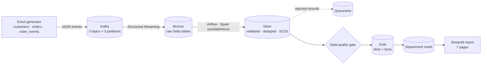

# E-Commerce Streaming Lakehouse with AI Analyst

An end-to-end data engineering project for a fictional online store, **Northstar Commerce**.
A simulator streams customer, order and order-lifecycle events into **Kafka**. **Spark
Structured Streaming** lands them in a **Delta Lake** Bronze layer. **Airflow** orchestrates
Spark jobs that build validated Silver tables, run a data-quality gate and publish a Gold
star schema with department marts. A **multi-page report** gives each department
(Sales, Marketing, Operations, Finance, Customer Service, Data Platform) its own page.



## Data engineering concepts shown

| Concept | Where |
| --- | --- |
| Event streaming, keyed partitions, idempotent producer | `generator/sinks.py`, Kafka topics `orders`, `order_events`, `customers` |
| Medallion architecture (Bronze / Silver / Gold) on Delta Lake | `lakehouse/bronze_stream.py`, `silver.py`, `gold.py` |
| Spark Structured Streaming with checkpoints (exactly-once into Delta) | `bronze_stream.py`: one query per topic, Kafka offsets kept in Bronze |
| Incremental processing | Silver reads Bronze as a stream with `trigger(availableNow=True)`; the checkpoint is the watermark |
| Idempotent upserts | Delta `MERGE` on business keys; quarantine appends use `txnAppId/txnVersion` |
| Deduplication of at-least-once delivery | duplicate events (~1%) removed by `event_id` / `order_id` |
| Schema enforcement and data validation | explicit schemas in `schemas.py`, rule-based rejection reasons in `silver.py` |
| Dead-letter / quarantine pattern | `silver/quarantine` keeps the raw payload, source offset and reason |
| Slowly Changing Dimension Type 2 | customer tier and address history in `silver/customers` |
| Point-in-time join | each order joins the customer version valid at order time (`gold.py`) |
| Dimensional modelling | `dim_date`, `dim_product`, `dim_customer` (with an unknown member), `fact_orders`, `fact_order_items` |
| Late and out-of-order events | lifecycle events arrive hours or days after the order; payloads keep event time |
| Data-quality gate | uniqueness, referential integrity, SCD2 validity, quarantine rate and freshness; failures stop Gold (`quality.py`) |
| Orchestration | Airflow DAG with sensor, task groups, a Spark pool, retries and parallel marts (`airflow/dags`) |
| Table maintenance | nightly Delta `OPTIMIZE` and `VACUUM` DAG |
| Analytics engineering | RFM segmentation, weekly cohort retention, revenue bridge, fulfilment SLAs |
| Testing | generator unit tests and Spark tests for validation, MERGE idempotency and SCD2 (`tests/`) |

## Tech stack

Kafka 3.9 (KRaft) · Spark 3.5 (PySpark, standalone cluster) · Delta Lake 3.2 · Airflow 2.10
(LocalExecutor + Postgres) · Streamlit + Plotly report reading Delta via `deltalake` · Docker Compose · pytest

## Repository layout

```text
airflow/dags/            lakehouse_medallion.py (every 10 min), lakehouse_maintenance.py (nightly)
docker/                  docker-compose.yml and Dockerfiles (spark, airflow, generator, report)
generator/               storefront simulator: customers, orders, lifecycle, dirty-data injection
lakehouse/               Spark jobs: bronze_stream, silver, quality, gold, maintenance, run.py entry point
reference_data/          product catalogue (48 SKUs, prices, unit costs, return risk)
report/                  Home.py + pages/ — one page per department
scripts/                 setup_local.ps1 and run_local.py (run everything without Docker)
tests/                   pytest suite
```

## Run the full stack with Docker

Requires Docker Desktop with the WSL 2 backend (enable WSL with admin rights:
`wsl --install --no-distribution`, then reboot) and about 8 GB of memory for Docker.

```powershell
Copy-Item .env.example .env
docker compose --env-file .env -f docker/docker-compose.yml up -d --build
```

The first start builds the images and replays 30 days of history, then keeps streaming live
orders. The Airflow DAG `lakehouse_medallion` runs every 10 minutes; the first Gold tables
appear a few minutes after startup.

| Service | URL |
| --- | --- |
| Department report | http://localhost:8501 |
| Airflow (admin / admin) | http://localhost:8080 |
| Kafka UI | http://localhost:8082 |
| Spark master / worker | http://localhost:8090 / http://localhost:8091 |
| Bronze streaming job (Spark UI) | http://localhost:4040 |

Stop with `docker compose --env-file .env -f docker/docker-compose.yml down` (add `-v` to
also delete Kafka, Postgres and generator state). Lake data lives in `./lake`.

## Run locally without Docker (Windows, no admin rights)

The same Spark jobs run in local mode. The generator writes to a file landing zone instead
of Kafka, and the Bronze job streams those files with the identical code path.

```powershell
powershell -ExecutionPolicy Bypass -File scripts\setup_local.ps1   # portable Java 17, winutils, Python 3.11, deps
.\.venv\Scripts\python.exe scripts\run_local.py --fresh --days 30  # generate → Bronze → Silver → DQ → Gold (~3 min)
.\.venv\Scripts\streamlit.exe run report\Home.py                   # open http://localhost:8501
```

Running `scripts\run_local.py` again without `--fresh` resumes the simulation from where it
stopped and processes only the new events.

## Pipeline details

**Events.** `orders` carries `order_placed` with line items. `order_events` carries
`payment_captured`, `payment_failed`, `order_cancelled`, `order_shipped`, `order_delivered`,
`return_requested`, `refund_issued` and `review_submitted`. `customers` carries
`customer_registered` and `customer_updated`. About 1% of events are sent twice, and about
0.6% are corrupted on purpose: truncated JSON, bad timestamps, missing keys, negative
quantities, unknown SKUs or unknown event types.

**Silver.** Each entity is validated against an explicit schema and business rules. Failing
records go to `silver/quarantine` with the first failing reason. Valid records are
deduplicated and merged: `orders`, `order_items`, `order_events`, `customers` (SCD2) and
`products`.

**Quality gate.** The gate runs 11 checks and appends the results to
`gold/dq_check_results`. An `error`-severity failure fails the Airflow task, so Gold never
publishes numbers from bad data.

**Gold marts by department.**

| Department | Tables | Report page shows |
| --- | --- | --- |
| Sales | `mart_sales_daily`, `mart_product_performance` | net sales by channel, category, region; top products |
| Marketing | `mart_marketing_channels`, `mart_customer_cohorts`, `mart_customer_rfm` | acquisition by source, campaign ROI, cohort retention, RFM segments |
| Operations | `mart_fulfillment_daily`, `mart_carrier_performance`, `mart_order_backlog` | hours to ship, carrier on-time rate, live backlog |
| Finance | `mart_finance_daily`, `mart_payment_methods` | revenue bridge, refunds, margin, payment failures |
| Customer service | `mart_cs_daily`, `mart_return_reasons`, `mart_cs_attention_queue` | returns, ratings, cases needing follow-up |
| Data platform | `mart_table_stats`, `mart_quarantine_summary`, `mart_ingestion_hourly`, `dq_check_results` | table freshness, DQ results, quarantine, throughput |

## Decision dashboard (single HTML file)

`showcase.html` is an offline, product-style dashboard ("Northstar Insights") generated from the Gold
tables: executive overview, one view per department, 7/14/30-day periods compared with the prior
period, KPI status against plan targets, and recommended actions computed from the data. A Platform
view shows the architecture and the Airflow DAG.

```powershell
.\.venv\Scripts\python.exe scriptsuild_showcase.py   # source: showcase/ (template, styles, app.js)
```

## AI analyst (agent over the warehouse)

`python -m ai.server` serves the dashboard at http://localhost:8000 with two AI features:

- **Ask AI**: a chat agent that answers any question by writing and running read-only DuckDB SQL against the
  Gold tables (`ai/agent.py`). Every answer shows the queries it ran.
- **AI decisions**: "Decisions needed" is generated by the agent from a KPI pack for the period plus its own
  follow-up queries (`ai/decisions.py`), cached per period and data version.

The model is any OpenAI-compatible endpoint; the default is OpenRouter's free
`nvidia/nemotron-3-super-120b-a12b:free`. Put your key in `.env` (git-ignored), never in `.env.example`:

```text
OPENROUTER_API_KEY=sk-or-...
LLM_BASE_URL=https://openrouter.ai/api/v1
LLM_MODEL=nvidia/nemotron-3-super-120b-a12b:free
```

SQL safety: one SELECT statement per call (checked by DuckDB's parser), external file access disabled,
results capped at 200 rows. After a pipeline run, call `POST /api/reload` or restart the server.

## Tests

```powershell
.\.venv\Scripts\python.exe -m pytest tests -v
```

## Troubleshooting

- **Docker engine never starts / `dockerDesktopLinuxEngine` pipe not found**: WSL is not
  installed. Run `wsl --install --no-distribution` in an administrator PowerShell, reboot,
  then start Docker Desktop. Until then, use the local mode above.
- **Airflow tasks fail with Spark connection errors**: check that `spark-master` and
  `spark-worker` are healthy (`docker compose ... ps`) and that the worker shows
  registered cores at http://localhost:8090.
- **Report says "No Gold data yet"**: wait for the first `lakehouse_medallion` run to finish,
  or run `scripts\run_local.py` for local mode.
